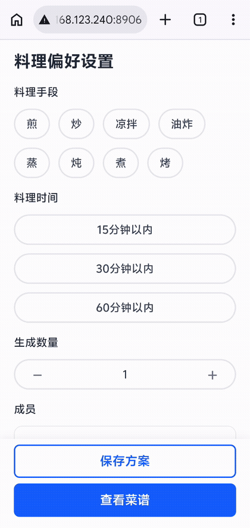
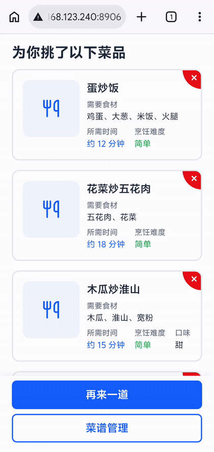
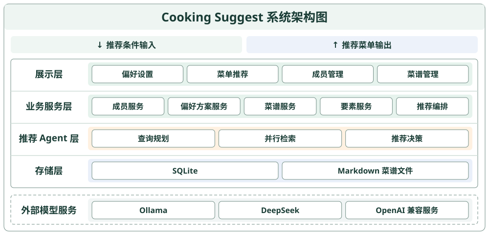
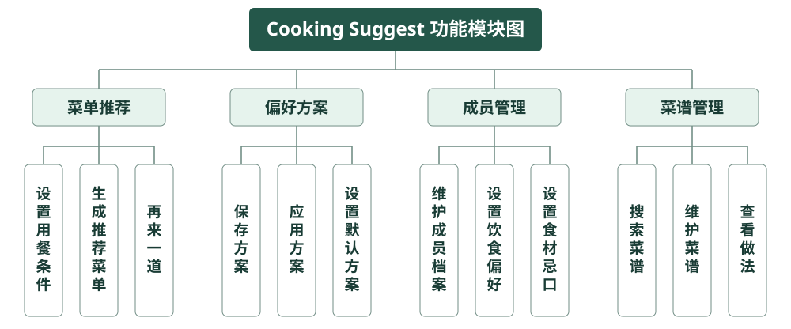
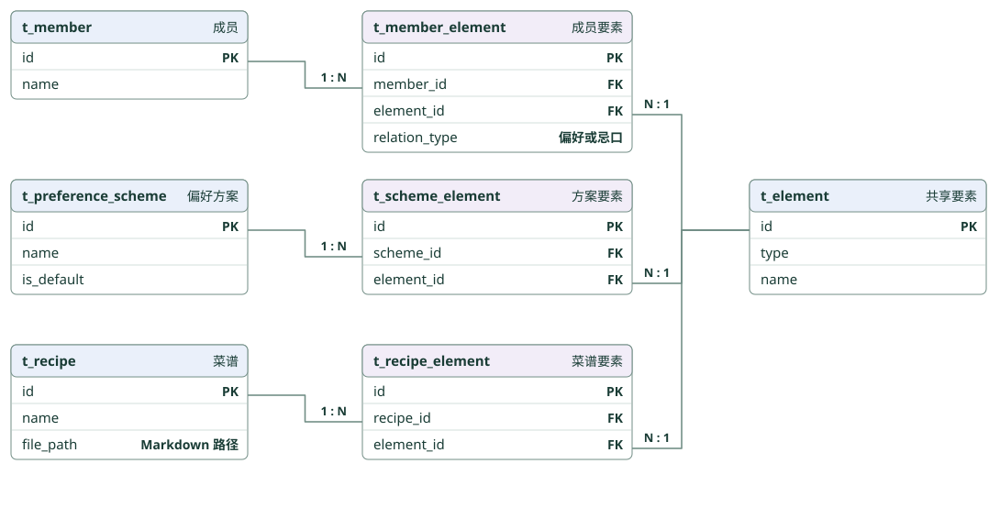
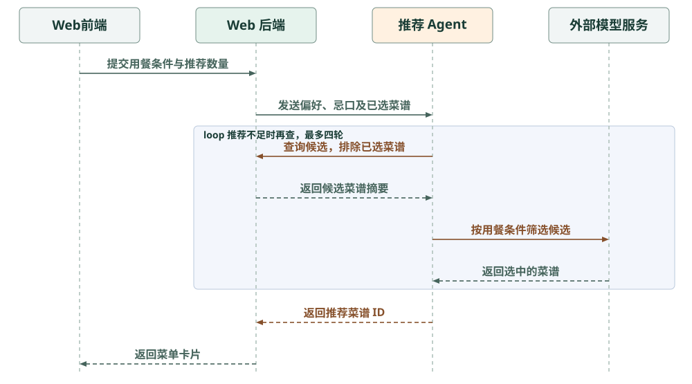

# Cooking Suggest

Cooking Suggest 是一个面向家庭掌勺人对于日常料理决策问题Agent应用。应用的核心在于使用大语言模型的能力，解决家庭成员忌口、偏好以及复杂条件下，常规算法无法很好识别食材的包含、同名等关系，同时又能够更加满足个性化的参考的复杂条件来搜索菜谱库中符合条件的菜谱，并帮助掌勺人进行快速决策。

项目使用 React、TypeScript 和 Vite 构建前端Web，使用 FastAPI 实现业务后端与独立 Agent 服务。业务数据保存在 SQLite，菜谱做法以 Markdown 保存。推荐流程由 LangGraph 编排，整体通过 Docker Compose 部署。

该项目主要用来验证在敏捷开发流程下，对于项目需求整理、任务拆分、界面设计、实际代码编写中，AI编码的辅助能力，同时验证简单 Agent 服务的设计和工程化难度。项目的编码模型和部署模型均使用 Deepseek 作为主要模型。项目架构上拆分成了H5web模块和agent模块，方便后续切换前端展示途径，可以将其web切换成小程序或者PC业务，或者将web服务切换成移动端应用。数据模块使用sqlite（结构化数据） + markdown（菜谱详情和描述），方便进行用户独立部署。

目前项目已经通过了基本流程的最小化验证，不过处于商业化动机不足，暂停研发。不过项目的架构可以作为后续其他 Agent 开发的参考。

## 功能演示

### 成员管理

### 菜谱推荐

### 菜谱管理

## 系统设计

### 系统架构图

### 功能模块图

### 简化表设计图

### 菜单推荐数据流时序图

## 项目目录

| 一级目录 | 用途 |
| --- | --- |
| `require-prompting/` | 通过 AI 对话梳理用户场景，将最初的做饭难题整理为产品需求、用户故事和验收标准。 |
| `sprint-plan/` | 按迭代记录 Sprint 目标、任务拆解、工作量估算和验收条件。 |
| `cooking-design-guide/` | 通过 AI 对话细化技术方案，记录服务边界、数据模型和接口约定。 |
| `cooking-ui-penpot/` | 将产品需求转化为 Penpot 界面设计稿，维护页面布局和视觉规范。 |
| `cooking-web-service/` | 包含移动端 Web 界面和后端 API，管理成员、偏好与菜谱，调用推荐服务并展示菜单。 |
| `cooking-agent-service/` | 菜单推荐的决策服务，用 LangGraph 编排候选菜谱检索与大语言模型筛选，向 Web 后端返回推荐结果。 |
| `data-create-agent/` | 批量生成用于联调的模拟菜谱，可以通过 Web API 导入数据。 |
| `cooking-builder/` | 使用 Docker Compose 构建和部署前端、Web 后端及 Agent 服务。 |
| `docs/` | 存放系统设计图和功能演示素材。 |
