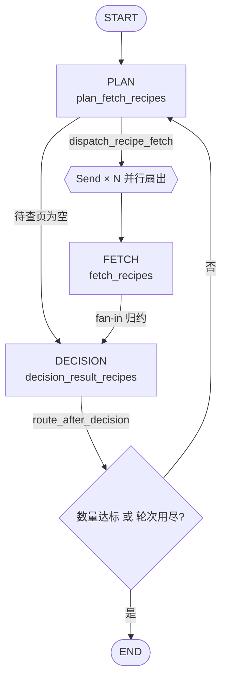

# Graph 设计文档 — 菜谱挑选工作流

> 说明 `cooking-agent-service` 中基于 LangGraph 编排的 Agent 业务流程与图结构。
> 相关代码：`agent/graph/graph.py`（图构建）、`agent/graph/nodes.py`（节点与路由）、
> `agent/graph/state.py`（状态）、`agent/services/recipes.py`（执行入口）。
> 对外接口见 [`api.md`](./api.md)，已知隐患与解决方法见 [`risks.md`](./risks.md)。

## 一、总体思路

Agent 的目标是：根据上层透传的**数量（`count`）**、**偏好/禁忌要素**和**已选菜谱**，
从 web-service 的菜谱池中挑选出合适的菜谱 id。

由于菜谱总量可能较大，工作流采用 **「少批量、多轮次」的 map-reduce 策略**：

1. **规划（map 前）**：统计排除已选菜谱后的候选总量，决定本轮要抓取哪些页；
2. **并行抓取（map）**：并行调用 web-service 分页接口，拉取多页菜谱摘要作为候选；
3. **决策（reduce）**：把候选与约束交给大模型，按禁忌硬过滤、偏好打分并挑选；
4. **回环**：若挑出的数量不足且轮次未用尽，清空候选后进入下一轮；否则结束。

限制最多 `MAX_ATTEMPTS` 轮，避免候选长期不足导致工作流死循环。

## 二、执行入口与调用链

```
POST /api/recipes
      │
      ▼
app/api/routes/recipes.py            get_recipes(request)
      │
      ▼
app/services/recipes.py              get_recipes(count, elements, dedup)   组装 GetRecipesParams
      │
      ▼
agent/services/recipes.py            invoke_get_recipes(params)
      │   _build_initial_state(params)  构造 RecipeAgentState
      ▼
agent/graph/graph.py                 cooking_suggest_agent.invoke(state)
      │
      ▼
agent/graph/nodes.py                  PLAN → FETCH(×N) → DECISION → (回环)
      │                                    反向调用 web-service 菜谱接口
      ▼
result["result_recipes"] → [recipe.id, ...] → 统一信封返回
```

## 三、状态定义（`RecipeAgentState`）

继承 `MessagesState`（携带 `messages` 通道）。列表字段通过 `Annotated` 声明归约器，
并行/跨轮次写入时按归约器合并。

| 字段                    | 类型                | 归约器            | 含义                                   |
| ----------------------- | ------------------- | ----------------- | -------------------------------------- |
| `count`               | int                 | 覆盖              | 本次需要获取的菜谱数量                 |
| `preference_elements` | list[Element]       | 覆盖              | 偏好的料理要素                         |
| `taboo_elements`      | list[Element]       | 覆盖              | 禁忌的料理要素（硬过滤）               |
| `select_recipes`      | list[Recipe]        | 覆盖              | 已选菜谱，参与去重与均衡，跨轮次不可改 |
| `reference_recipes`   | list[RecipeSummary] | `clearable_add` | 本轮候选菜谱；写入空列表表示清空       |
| `result_recipes`      | list[RecipeSummary] | `operator.add`  | 各轮决策产出的推荐菜谱，累积           |
| `pending_pages`       | list[int]           | 覆盖              | 本轮待并行查询的页码                   |
| `page_size`           | int                 | 覆盖              | 本轮单页条数                           |
| `page`                | int                 | 覆盖              | 当前查询页码（由 `Send` 注入）       |
| `total`               | int                 | 覆盖              | 排除已选菜谱后的候选总量               |
| `attempts`            | int                 | 覆盖              | 已执行的查询轮次                       |
| `fetched_pages`       | list[int]           | `operator.add`  | 已拉取的页码，累积                     |

输出状态 `OutputState` 仅暴露 `result_recipes`，屏蔽中间查询状态。

> `clearable_add` 是对 LangGraph 默认追加归约的扩展：右侧写入 `[]` 时视为清空信号，
> 用于在每轮开始时丢弃上一轮候选。

## 四、节点（`agent/graph/nodes.py`）

| 节点常量     | 函数                        | 职责                                | 主要写入                                                                                       |
| ------------ | --------------------------- | ----------------------------------- | ---------------------------------------------------------------------------------------------- |
| `PLAN`     | `plan_fetch_recipes`      | 统计候选总量、规划本轮页码、轮次 +1 | `attempts` / `total` / `page_size` / `pending_pages`，必要时清空 `reference_recipes` |
| `FETCH`    | `fetch_recipes`           | 按单页参数拉取菜谱摘要              | `reference_recipes` / `fetched_pages`                                                      |
| `DECISION` | `decision_result_recipes` | 大模型按约束过滤、打分、挑选        | `result_recipes`                                                                             |

### PLAN 规划规则

- 以 `select_recipes` 为 `exclude_recipe_ids`，先取 `page=1, page_size=1` 获取剩余总量 `total`；
- `total > 20`：固定 `page_size = 3`，从全部页号中**随机抽取 4 页**并行查询
  （随机抽样避免每轮反复命中同一批菜谱）；
- `total <= 20`：`page_size = total`，仅查第 1 页（一次性取完剩余候选）；
- 进入新一轮时写入 `reference_recipes = []`，借助 `clearable_add` 清空上一轮候选。

### FETCH 与并行扇出

`dispatch_recipe_fetch` 依据 `pending_pages` 返回一组 `Send`，每页对应一个 `FETCH`
调用，由 LangGraph 并行执行；多个 `FETCH` 的输出经归约器合并为完整候选集，全部完成后
汇聚到 `DECISION`。

`FETCH` 的输入状态由 `Send` 注入，仅包含 `page` / `page_size` / `select_recipes`。

### DECISION 决策

- 候选为空时直接返回空结果，不发起模型调用；
- 否则将 `count`、偏好/禁忌要素、已选菜谱、候选菜谱装配进提示词
  （`system-get-recipes.md` + `human-get-recipes.md`），
  经 `trustcall` 结构化抽取（`ResultRecipeList`）得到推荐菜谱数组。

## 五、图结构

### ASCII 结构图

```
                              START
                                │
                                ▼
                        ┌───────────────┐
                        │     PLAN      │  plan_fetch_recipes
                        │  规划查询计划  │
                        └───────┬───────┘
                                │
                  dispatch_recipe_fetch（条件路由）
                    ┌───────────┴────────────┐
         待查页非空 │                         │ 待查页为空
                    ▼                         │
        ┌───────────────────────┐             │
        │  Send × N（并行扇出）  │             │
        └───────────────────────┘             │
           │      │      │      │              │
           ▼      ▼      ▼      ▼              │
        ┌─────┐┌─────┐┌─────┐┌─────┐           │
        │FETCH││FETCH││FETCH││FETCH│ fetch_recipes
        └──┬──┘└──┬──┘└──┬──┘└──┬──┘           │
           └──────┴──┬───┴──────┘              │
                     │ fan-in（归约）           │
                     ▼                         ▼
              ┌─────────────────────────────────┐
              │            DECISION             │ decision_result_recipes
              │       大模型按约束挑选菜谱       │
              └────────────────┬────────────────┘
                               │
                 route_after_decision（条件路由）
                    ┌──────────┴───────────┐
       数量不足       │                      │  数量达标 或 轮次用尽
       且轮次未用尽   ▼                      ▼
                回到 PLAN 回环          ┌─────────┐
              （最多 4 轮）            │   END   │
                 └────────────────────▶└─────────┘
```

### Mermaid 结构图



## 六、业务流程（时序）

1. web-service 组装 `count` + 富化 `elements` + 翻译后的 `dedup`，调用 `POST /api/recipes`；
2. `invoke_get_recipes` 构建初始状态：按 `relation_type` 拆分偏好/禁忌，`dedup` 写入
   `select_recipes`，查询控制字段清零；
3. **PLAN**：抓取剩余候选总量并规划页码，`attempts` +1；
4. **FETCH ×N**：并行从 web-service 拉取候选摘要（带 `exclude_recipe_ids` 去重）；
5. **DECISION**：候选非空时由大模型按「禁忌硬过滤 → 偏好/均衡打分 → 取前 `count` 个」挑选；
6. **路由**：`result_recipes` 数量 ≥ `count` 或 `attempts` ≥ 4 → `END`；否则回到 PLAN 再查一轮；
7. 结束时从 `result_recipes` 提取 id 数组返回，无合适菜谱则为 `[]`。
